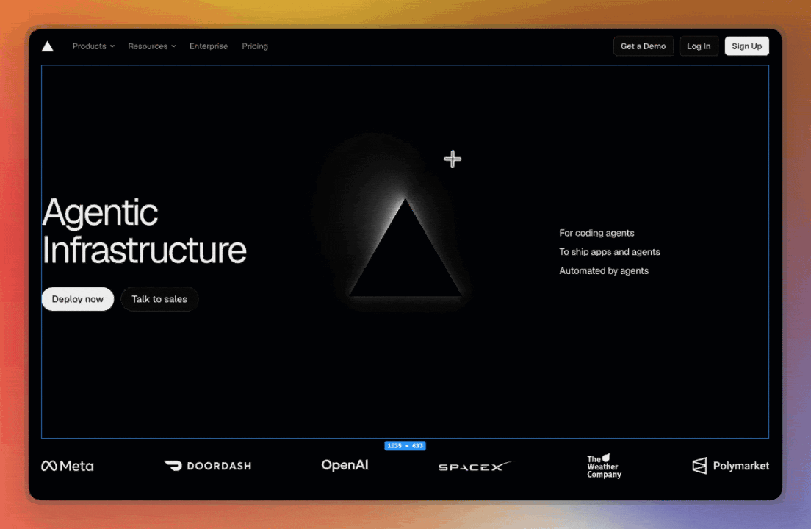

  

<h1 align="center">GapRay</h1>

  X-ray any webpage like Figma redlines. 
  Sizes, padding, gaps, radius and type. Free, open source, 100% local.

  

## Why

Designers check built pages against their designs every day. DevTools has the numbers, but it is built for developers: boxes inside panels inside tabs. GapRay shows the same numbers the way Figma does, right on the page.

## Features

- **Hover** any element to see its outline and size.
- **Click** for one clean card: size, font, weight, line height, color, padding, radius.
- **Drag** over an area to x-ray it live: sizes, hatched padding, gaps between items, radius, and every color used.
- **Hold Alt (Option)** and hover to measure the distance between two elements, like in Figma.
- **Click any value** to copy it.
- Works on light and dark pages, stays correct when you scroll or resize.
- Numbers come from real geometry and computed styles, checked against Chrome DevTools.

## Install

GapRay is not on the Chrome Web Store yet. To install it from this repo:

1. Download this repo (Code → Download ZIP) and unzip it.
2. Open `chrome://extensions` and turn on **Developer mode**.
3. Click **Load unpacked** and pick the `extension` folder.
4. Pin GapRay to your toolbar.

## Use

| Action | How |
|---|---|
| Turn on / off | `Cmd+Shift+X` (Mac) or `Ctrl+Shift+X` (Windows), or the toolbar menu |
| Inspect one element | Click it |
| X-ray an area | Drag over it |
| Measure distance | Select an element, hold `Alt` / `Option`, hover another |
| Copy a value | Click it |
| Exit | `Esc` |

Change the shortcut anytime in GapRay **Settings**.

## Privacy

GapRay runs entirely in your browser. No accounts, no servers, no analytics, no network calls.

It only asks for two permissions:

- `activeTab`: runs only on the tab where you turn it on.
- `scripting`: draws the overlay on that tab.

The overlay never changes the page, and the page never sees your data.

## What it's not

- Not a page editor. It reads the page, it never changes it.
- Not a replacement for DevTools. It is the designer's view of the same numbers.

## Changelog

See [CHANGELOG.md](CHANGELOG.md). The core inspector stays free and open source forever.

## Contributing

Issues and pull requests are welcome. The code is plain JavaScript (Manifest V3), with no build step and no dependencies. Edit the files in `extension/`, then reload GapRay in `chrome://extensions`.

Please open an issue before a big change, so we can agree on it first.

## License

[MIT](LICENSE). Made by [Fateh Zid](https://x.com/fatehzid).
